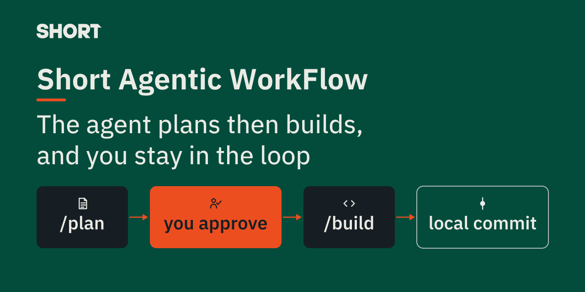
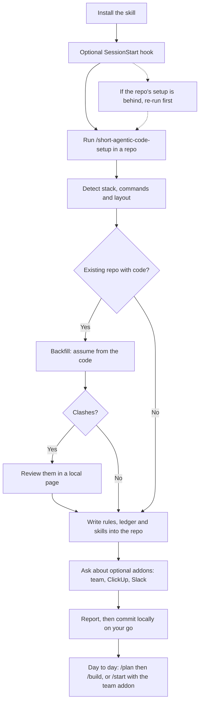

# Short Agentic Code Setup (Claude Code skill)

<p align="center"></p>

> This harness is a highly simplified version of the agentic workflow we use at Short.
> The ideas are the same — rules and knowledge live in the repository, the agent plans
> then builds, and you stay in the loop — but the setup we run day to day has more
> around them.

A Claude Code skill that installs a small, self-contained agentic working system into
any code repository, new or existing. Every file it writes lives in that repository;
there is no shared rules folder and no separate docs repo.

The base has no tickets, no PRs and no reviews by default. An optional **team addon** brings them back.

## How it works



You install the skill on your machine and run `/short-agentic-code-setup` in a
repository. It detects the stack and, in a repo that already has code, backfills a
knowledge ledger from what the code actually does — entries the code consistently
follows are recorded as approved, and only clashes go to a temporary local review
page. It then writes the rules, the ledger, and the `/plan` and `/build` skills into
that repo, and asks whether to add the optional team, ClickUp, or Slack addons.
Blocks marked `short-agentic:…` are owned by the skill, so a later re-run can update
them without touching the rest of the file. Nothing is committed until you say so,
and nothing is pushed. A SessionStart hook can keep the skill itself up to date and,
when a repo's setup stamp is behind, tell Claude to re-run before the task.

## What it adds to a repo

| Part | Files |
|---|---|
| Rules the agent always loads | `AGENTS.md` (+ `CLAUDE.md` = `@AGENTS.md`), `CONTEXT.md` (project vocabulary) |
| Knowledge ledger with a gate | `docs/agents/DECISIONS.md`, `PATTERNS.md`, `CONTRACTS.md` (C- IDs), `OPEN-QUESTIONS.md`, `ARCHITECTURE.md` |
| Ledger tooling | `docs/agents/tools/ledger-lint.py` (checks IDs, fields, links; rebuilds indexes; moves superseded entries to `*-SUPERSEDED.md`, out of the always-loaded files; `--next D`); index + topic files above ~150 lines; `Confirmed:` dates collapse in plans |
| Guide for people | `docs/agents/README.md` |
| Backfill (existing repos) | read-only agents mine code, git history, PRs, docs and memory; clashes only go to a temporary review UI; record in `BACKFILL-REVIEW.md` |
| Plan, then build (tests first) | `.claude/skills/plan`, `.claude/skills/build`, `.claude/agents/planner.md`, `builder.md` |
| Visual apps: design guardrails | `docs/design/DESIGN.md` (rules, procedure, real tokens), `registry.yaml` (DS- IDs), `screens/`, `mocks/`; designs change only in the repo and are published one way to a Claude Design board to be confirmed |
| Optional ClickUp addon | CI comments branch/PR links on every ticket the PR covers, moves each to "in review" when the PR is ready (never backwards), comments "released in" on every ticket of a tag; publishes `docs/agents` to a ClickUp Doc (pages edited in ClickUp are skipped and reported) |
| Optional Slack addon | CI posts "<PR> Ready for review." and a release notice (tickets, open manual tests) through a webhook |
| Optional team addon | `STATE.md` (tickets in flight), ticket-first work, deliveries (related tickets on one branch and draft PR; stacked PRs only when needed), 5-section PR template, `/start <ticket>` pipeline (lane proposed by risk; product owner → plan → test author → build → reviewer, 3 user gates), parallel builders on private branches the conductor integrates, handoffs and a journal per ticket, manual tests, a self-contained CI check |

The skill asks every time whether to add each addon (team, ClickUp, Slack). For every
CI workflow it asks which runner to use (a self-hosted runner is
recommended when you have one). Addon automation is a dry run (log only) until you set the repository
variable `AUTOMATION_LIVE=true`; tokens live in 1Password and reach CI through a
repository secret or a 1Password service account, never through files.

### The gate
*Does this change something already approved?* Additive work (a candidate pattern,
an open question, code that follows approved entries) is done, then reported. A
change to an approved decision or pattern is a written PROPOSAL, and the agent waits.

### Existing repos: the backfill
On the first run, parallel read-only agents mine the repo through five lenses:
structure, contracts, rules, history (full git log and merged PRs) and docs (CLAUDE.md,
AGENTS.md, README, docs/, the local Claude memory).

- **Assume from the code.** What the code consistently follows becomes an `approved`
  entry with `path:line` evidence. Nobody has to confirm it.
- **Review only clashes:** docs vs code, two ways of doing one thing, contradictions,
  contract sides that disagree. The skill opens a temporary local review page: one
  clash per card, keys `1`–`9` / `R` (recommendation) / `E` (own answer) / `X`
  (reject), "Accept all recommendations", instant save. "Done" stops it, and the
  answers become ledger entries.
- **Contracts:** the repo that provides an interface owns its `C-` entry; consumers
  link to it. With the other repo on disk, both sides are compared.

Stale facts are dropped with a reason. No rule is dropped.

## Install

```bash
git clone https://github.com/ShortDotInc/Short-Agentic-WorkFlow.git \
  ~/Work/Short-Agentic-WorkFlow
ln -s ~/Work/Short-Agentic-WorkFlow \
  ~/.claude/skills/short-agentic-code-setup
```

Update: `git -C ~/Work/Short-Agentic-WorkFlow pull`,
or install the auto update hook in `~/.claude/settings.json`:

```json
"SessionStart": [{"matcher": "startup|clear", "hooks": [{"type": "command",
  "command": "python3 ~/.claude/skills/short-agentic-code-setup/tools/check-update.py",
  "timeout": 20}]}]
```

At session start the hook pulls the skill (fast-forward only, at most every 6 hours).
In a repo whose `docs/agents/.setup-version` is older than `VERSION`, Claude runs the
re-run before the task. The commit still needs your go; nothing is pushed.

Upgrading from the old name (Graffino Agentic Code Setup): the clone keeps
working (GitHub redirects the old URL), but point it at the new one with
`git remote set-url origin https://github.com/ShortDotInc/Short-Agentic-WorkFlow.git`,
rename the symlink to `~/.claude/skills/short-agentic-code-setup`, and update the hook
path. Repos set up before 1.6 keep their `graffino-agentic` markers until the next
re-run renames them.

## Use

In a repo, in Claude Code:

```text
/short-agentic-code-setup
```

The skill detects the stack, commands and layout, writes the files, shows a report
(files, ledger entries, facts moved or dropped, design findings, failed commands), and
commits only on your go: branch `chore/agentic-code-setup`, merged into the default
branch locally. It never pushes.

Then, day to day in that repo: `/plan` → approve → `/build`. With the team addon:
`/start ABC-123` (it proposes the full or fast lane by risk; `/start ABC-123 fast`
asks for the fast lane).

## Re-run and versions

Text between `<!-- short-agentic:begin vN -->` and `<!-- short-agentic:end -->`
(and the `short-agentic:team` markers) belongs to the skill. A re-run replaces those
blocks with the current templates, and keeps all repo text and all ledger entries.
`docs/agents/.setup-version` records the full release applied to the repo; a re-run
applies every release after it. Files the repo changed itself (variants) are merged, not overwritten.
The marker carries the major version; releases follow semver (`VERSION`,
`CHANGELOG.md`).

## Layout

```text
SKILL.md                  the procedure Claude follows
templates/                base files (AGENTS, CLAUDE, CONTEXT, ledger, plan/build, agents)
templates/design/         DESIGN.md + registry.yaml for visual apps
templates/backfill/       archaeologist brief + the temporary review UI (server + page)
templates/team/           the optional team addon (rules, agents, /start, journal, PR template, CI)
templates/clickup/        the optional ClickUp addon (clickup-sync.py, workflow, settings, rules)
templates/slack/          the optional Slack addon (slack-notify.py, workflow, settings, rules)
tools/check-update.py     the auto update check (SessionStart hook)
```
